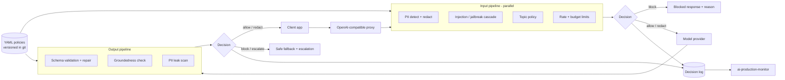

# 🛡️ AI Safety Gateway

**A policy-enforcing proxy between applications and LLMs: input screening, output validation, and a full audit trail in one place.**

  

> 🚧 **This project is in the design phase.** This README documents the problem, planned architecture, and tradeoffs. Progress is tracked in the [Roadmap](#-roadmap), and measured results will be added to the [Design Log](#-design-log) as each phase ships.

---

## 📌 The Problem

When safety checks live inside each application, they drift apart: one app redacts emails, another doesn't; one validates JSON, another returns whatever the model produced. Nobody can answer *"what is our policy, and is it actually being enforced?"*

Meanwhile the risks are real:
- **Prompt injection** hidden in retrieved documents or web pages
- **PII leaking** into model providers or back out in responses
- **Malformed structured output** breaking downstream systems
- **Runaway spend** from a single tenant or bug

## 💡 The Solution

A single gateway every app routes through. Policy is **defined once, versioned in git, tested in CI, and logged on every decision**. It's OpenAI-API-compatible, so adopting it is a base-URL change.

Its hardest constraint: it must be **fast and precise enough that nobody is tempted to route around it**.

### Planned capabilities
- OpenAI-compatible proxy endpoint
- PII detection and redaction on input and output
- Layered prompt-injection / jailbreak detection
- Declarative YAML policies with per-route and per-tenant overrides, hot-reloaded
- Output schema validation with repair-and-retry
- Groundedness checks against retrieved context (sampled or high-stakes routes)
- Rate and budget limits per tenant
- Decision log with rule ID, policy version, and latency for every allow/block

---

## 🏗️ Architecture



### Flow
1. **Receive** – the app sends a normal OpenAI-style request to the gateway.
2. **Screen input** – PII, injection, topic, and budget checks run **in parallel**, using a cost cascade: regex/denylists → small classifiers → LLM judgment only when needed.
3. **Decide** – allow, redact, or block according to the active policy version.
4. **Forward** – the cleaned request goes to the model provider.
5. **Validate output** – schema check with repair-and-retry, groundedness (sampled or on high-stakes routes), PII leak scan.
6. **Respond** – allow, redact, block, or escalate.
7. **Log** – every decision records rule ID, policy version, per-check latency, and payload hash, and flows into the monitor.

---

## 🧰 Tech Stack (planned)

| Layer | Choice | Why |
|---|---|---|
| Runtime | FastAPI + asyncio fan-out | Parallel checks, low overhead |
| Detection cascade | Regex/denylists → small classifiers → LLM judge | Cost and latency grow only when needed |
| PII | Microsoft Presidio + custom recognizers | Solid baseline, extensible for domain entities |
| Validation | Pydantic + JSON Schema with repair loop | Fix malformed output instead of passing it on |
| Policy | YAML in git, hot reload | Policy is config, not code |
| Prior art studied | Guardrails AI, NeMo Guardrails, Llama Guard | Policy-modeling patterns |

---

## ⚖️ Key Design Decisions & Tradeoffs

| Decision | Chosen | Alternative | Tradeoff |
|---|---|---|---|
| Deployment | Central gateway | Checks inside each app | Extra network hop, but one consistent, auditable policy |
| API shape | OpenAI-compatible | Custom API | Constrained to that shape; adoption is a one-line change |
| Check execution | Parallel | Sequential | More complex, keeps latency near the slowest single check |
| Detection | Cheap-first cascade | LLM judge for everything | Slightly lower recall on subtle attacks; far lower cost and latency |
| Tuning priority | Precision (few false positives) | Max recall | Some attacks may pass, but legitimate work isn't blocked |
| Failure mode | Explicit fail-open/closed **per rule** | One global setting | More config, but availability vs. safety is a deliberate, tested choice |

---

## 🧗 Hard Problems I'm Planning For

- **False positives** – an over-eager filter destroys trust faster than a missed edge case. → Tune for precision, log every block, provide an appeal path.
- **Latency budget** – every check taxes every request. → Parallel checks, caching by payload hash, keep LLM checks off the hot path.
- **Injection is unsolved** – detection is probabilistic and attackers adapt. → Pair detection with structural defenses: least-privilege tools, confirmation for consequential actions, treating retrieved content as data, never instructions.
- **Groundedness is expensive** – → Sample it, or use a cheap NLI model; full LLM verification only on high-stakes routes.
- **Policy sprawl** – rules pile up and contradict. → Version policies, require tests per rule, review on a schedule.

---

## 📏 How I'll Measure It

All values are **targets**.

| Metric | What it tells me | Target |
|---|---|---|
| False positive rate (benign corpus) | Will people tolerate it? | ≤ 1% |
| Detection recall (red-team set) | Does it catch attacks? | Reported per attack category; tracked over time |
| Added latency | Cost to every request | P50 < 50ms, P99 < 200ms (excluding optional LLM checks) |
| Coverage | % of LLM traffic routed through it | 100% of portfolio apps |

---

## 🗺️ Roadmap

- [ ] **Phase 1 – Pass-through:** transparent proxy with full request/response logging; apps switch with no behavior change
- [ ] **Phase 2 – PII + schemas:** redaction on input/output, schema validation with repair
- [ ] **Phase 3 – Injection:** layered classifier cascade; precision/recall on a red-team set
- [ ] **Phase 4 – Policy engine:** YAML policies, per-tenant overrides, hot reload without redeploy
- [ ] **Phase 5 – Hardening:** groundedness checks, budget limits, policy test suite in CI

**Stretch:** semantic caching · shadow mode to test new policies on live traffic without enforcing · automated red-teaming against my own rules

### Non-goals (for now)
- Claiming to stop all prompt injection
- Content moderation for end-user-generated media
- Replacing provider-side safety systems

---

## 📁 Planned Repo Structure

```
ai-safety-gateway/
├── proxy/            # OpenAI-compatible endpoints, provider clients
├── checks/
│   ├── input/        # PII, injection cascade, topic, limits
│   └── output/       # schema repair, groundedness, PII leak scan
├── policy/           # YAML loader, overrides, hot reload
├── policies/         # the actual policy files (versioned)
├── decision_log/     # logging + export to monitor
├── redteam/          # attack corpus + benign corpus
├── docs/decisions/
└── tests/            # one test per policy rule
```

---

## 🔗 Part of a Larger System

This is **layer 6 (Guardrails)**. It sits in front of everything.

| Layer | Repo |
|---|---|
| Retrieval | [codebase-copilot](https://github.com/khushi0101/codebase-copilot) – routed through this gateway |
| Evals | [llm-eval-bench](https://github.com/khushi0101/llm-eval-bench) – measures false positive and recall rates |
| Agents | [sales-research-agent](https://github.com/khushi0101/sales-research-agent) – fetched web content screened for injection |
| Automation | [lead-to-crm-automation](https://github.com/khushi0101/lead-to-crm-automation) – PII redaction on lead data |
| Observability | [ai-production-monitor](https://github.com/khushi0101/ai-production-monitor) – receives the decision log |
| Guardrails | **ai-safety-gateway** (you are here) |

---

## 🎬 Planned Demo

Invite someone to try to break it. Show a legitimate request passing cleanly, an injection hidden inside a retrieved document being caught, and a customer email address redacted on the way out. Open the decision log with rule IDs and per-check latency, then run the red-team suite in CI. The point isn't that it catches everything, but that I know exactly what it catches and what it doesn't.

---

## 🚀 Getting Started

*Coming with Phase 1.*

---

## 📓 Design Log

| Date | Change | Metric | Before → After | Decision |
|---|---|---|---|---|
| – | – | – | – | – |

---

## 👩‍💻 Author

**Khushi Agrawal** · [GitHub](https://github.com/khushi0101) · [LinkedIn](https://linkedin.com/in/khushi--agrawal)
